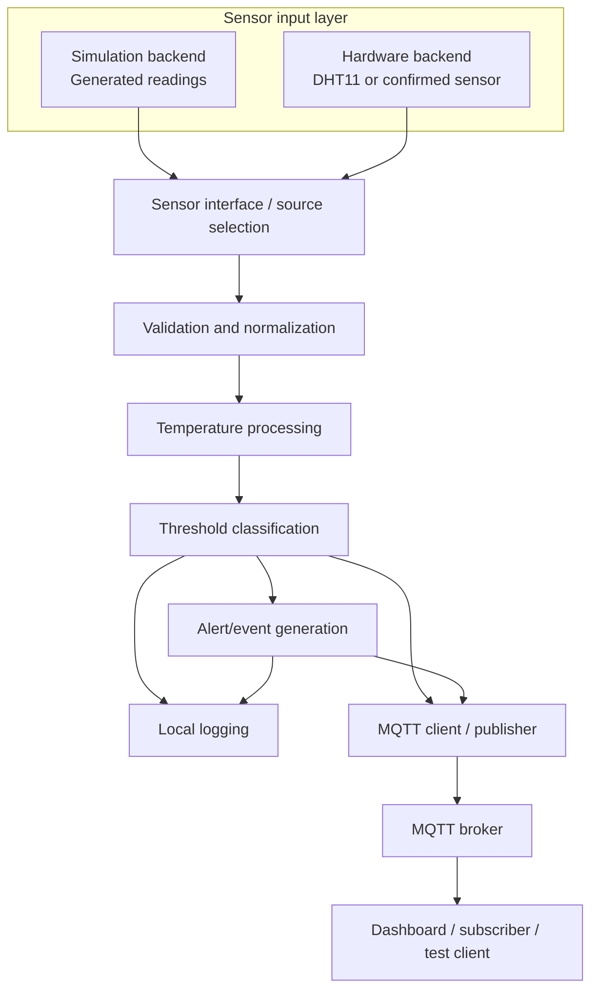
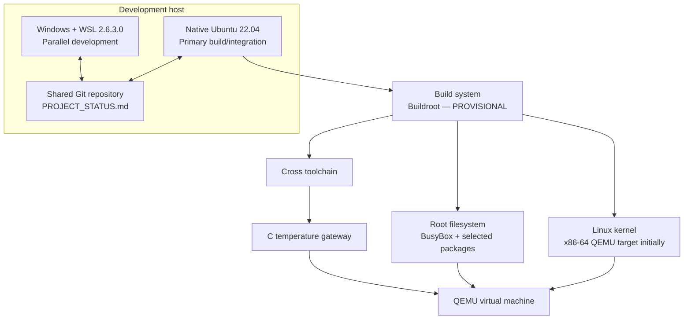

# Project Architecture
## IoT Temperature-Monitoring Gateway — Track B

**Status:** Initial architecture baseline. Build system, package versions, physical board, and hardware driver are subject to confirmation.

## 1. Architecture goals

- Keep sensor acquisition separate from common application behavior.
- Make simulation a first-class, explicitly labelled input mode.
- Keep processing, thresholds, logging, and MQTT independent of the sensor backend.
- Build a minimal Linux userspace for a focused gateway role.
- Support QEMU software testing before physical hardware arrives.
- Avoid committing to board-specific configuration before the board is identified.

## 2. High-level architecture



## 3. Linux platform architecture



## 4. Component descriptions

### 4.1 Sensor input layer

The sensor layer provides a stable interface to the rest of the application. It should expose operations such as initialization, reading a sample, reporting the source mode, and cleanup.

Conceptual interface (not a final API until the application task defines it):

```c
typedef enum {
    SENSOR_SOURCE_SIMULATED,
    SENSOR_SOURCE_HARDWARE
} sensor_source_t;

typedef struct {
    double temperature_c;
    int valid;
    sensor_source_t source;
    /* Timestamp representation to be selected by implementation. */
} temperature_sample_t;
```

The actual header must define error codes, timestamp type, ownership, and units consistently. Do not copy this sketch as a final interface without reviewing it with the application owner.

### 4.2 Simulation mode — Phase 1

The simulator generates plausible values for normal and elevated temperatures. It may use a fixed scenario for repeatable demonstrations and a bounded varying mode for longer runs. It should support test cases for invalid values, read errors, and threshold boundaries.

Every sample, log record, and MQTT payload must identify its source as `SIMULATED`. Simulation must never be described as a physical sensor measurement.

### 4.3 Hardware mode — Phase 2

The hardware backend will be implemented only after confirming the exact board, sensor, electrical levels, GPIO controller, kernel, and available driver/interface.

For a DHT11, the application may interact through a suitable kernel driver exposed by an appropriate Linux interface, or another carefully selected implementation. Do not assume that arbitrary userspace bit-banging will provide reliable timing. Do not assume I²C or SPI: DHT11 uses a proprietary single-wire digital signaling protocol.

### 4.4 Validation and processing

Validation checks whether a reading is available, finite, within a configured plausible range, and represented in the expected unit. Invalid samples should be rejected or marked as errors; they must not silently become zero degrees or a valid status.

Processing should normalize the sample and attach timestamp/source metadata. Any smoothing or averaging should be optional and documented so the original measurement is not obscured.

### 4.5 Threshold classification

Thresholds are configuration, not hard-coded assumptions. Define boundary semantics explicitly. For example, if warning threshold is W and critical threshold is C, document whether `temperature >= C` is Critical, `temperature >= W` is Warning, and lower valid values are Normal. Validate that C is greater than W.

### 4.6 Alerts

Generate an alert when a sample enters Warning or Critical, and consider avoiding repeated alert floods by publishing on state changes plus periodic status if required. Record alert severity, value, timestamp, and source mode.

### 4.7 Logging

Logs should include timestamp, temperature, unit, classification, and source mode. Include errors for sensor failures and MQTT connection/publish failures. A simple file or standard output/syslog approach may be selected based on the chosen root filesystem and time budget. Avoid logging secrets such as MQTT passwords.

### 4.8 MQTT communication

The client publishes structured messages to a configured broker and topic. A proposed JSON payload:

```json
{
  "timestamp": "2026-01-01T12:00:00Z",
  "temperature_c": 36.0,
  "status": "WARNING",
  "source": "SIMULATED"
}
```

This is an example schema, not a claim about a tested implementation. The final schema, timestamp policy, topic names, QoS, retain behavior, authentication, and reconnect strategy must be recorded in configuration/documentation.

Proposed topic pattern (PROVISIONAL):
- `iot/temperature/readings`
- `iot/temperature/alerts`

Use broker authentication where feasible. Do not expose credentials in Git or logs.

## 5. Linux operating-system layer

### 5.1 Build system

Buildroot is the provisional selection for generating the toolchain, kernel, root filesystem, and selected packages. Pin an exact release after comparing host compatibility and assignment needs.

### 5.2 Kernel and drivers/interfaces

For the initial x86-64 QEMU target, configure only what the virtual machine and application require: architecture support, console, block device/filesystem support for the chosen rootfs, networking, and relevant virtual devices.

For future physical hardware:
- Confirm CPU architecture and board support first.
- Confirm GPIO controller and kernel GPIO framework support.
- Select a maintained sensor driver/interface compatible with the exact kernel.
- Confirm whether device-tree nodes or overlays are required.
- Confirm whether the board exposes a safe and supported sensor connection.
- Verify the actual electrical and timing behavior on hardware.

I²C and SPI are not the DHT11 protocol. UART may be useful for board console/debug, but is not the DHT11 sensor data interface.

### 5.3 Root filesystem and userland

A minimal userspace may include BusyBox, the monitoring application, required shared libraries, CA certificates if TLS is used, network configuration tools, and diagnostic utilities. `libmosquitto` is a candidate MQTT client library, subject to Buildroot package availability and dependency footprint.

Avoid adding a desktop environment, unnecessary language runtimes, or general-purpose services without a requirement.

### 5.4 Startup

BusyBox init is the provisional init system. The monitoring program should be launched through an init script or equivalent startup mechanism. The script should handle permissions, configuration, logging, and service restart policy deliberately. Confirm the final mechanism against the generated rootfs and init configuration.

### 5.5 Filesystem and security

Potential measures:
1. Include only required packages and services.
2. Run the monitoring process as a dedicated unprivileged user where practical.
3. Restrict network listeners and use MQTT authentication/TLS where feasible.
4. Protect credentials and configuration permissions.
5. Consider read-only root with a separate writable data/log area after basic boot and logging work.
6. Set restrictive file permissions and avoid unnecessary setuid tools.

At least three measures must be implemented and verified, not merely listed. A read-only root filesystem is a stretch goal if it risks the working demo.

## 6. QEMU testing

QEMU will run the initial x86-64 image as a guest. It can test boot, rootfs, startup, application logic, virtual networking, MQTT connectivity, logs, and guest resource behavior. It does not automatically emulate the physical sensor, board GPIO, electrical signaling, or timing.

Prefer a terminal/serial-console QEMU run initially. Record QEMU version, machine type, vCPU count, memory, disk/image format, networking mode, and command line for reproducibility.

## 7. Data flow

1. Selected backend returns a sample or an explicit error.
2. Application validates the sample.
3. Valid sample is normalized and timestamped.
4. Threshold module assigns Normal, Warning, or Critical.
5. Logger records sample/status/source.
6. Alert module creates an event on configured conditions.
7. MQTT client publishes reading and alert messages.
8. Failures are logged and handled without falsely marking a sample or publish successful.

## 8. Physical integration boundary

The following remain PENDING until hardware identification:
- Board vendor/model/revision.
- CPU architecture and bootloader.
- Kernel defconfig and exact kernel version.
- Device tree and overlays.
- GPIO controller and pin mapping.
- Sensor exact model/revision and electrical requirements.
- Driver/module and userspace interface.
- Image format, boot medium, and flashing method.

Before wiring, consult the board and sensor documentation, confirm voltage compatibility, and power down as required. Never assume a GPIO is 5-V tolerant.
